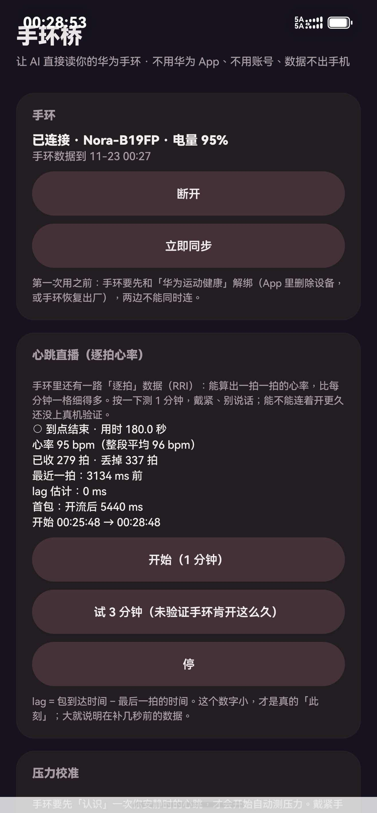

# Huawei Band Bridge

**Let your AI read your Huawei band directly. No Huawei Health app, no Huawei ID, no cloud.**
([中文](README.md))

> 🧪 **Test release** (currently 0.1.4). The protocol core runs on one HUAWEI Band 10. The app and the MCP
> server are still being checked feature by feature on a real device. Every item below carries an evidence
> level, and nothing that has not run on a device is called "verified".



*Screenshot of 0.1.1 on a HUAWEI Band 10 + HarmonyOS phone; that heartbeat-live run measured a lag of 0 ms.
0.1.4 has a new interface; new screenshots will follow once it has been checked on the device.*

## What it is

1. An **Android app** that talks to a Huawei band over Bluetooth using Huawei's own private protocol
   (including HiChain authentication) and stores heart rate, SpO₂, steps, TruSleep, stress and emotion
   **on the phone only**.
2. An **MCP server** on the same phone (7 tools), so Claude, Cursor and other AI clients can query that data.
3. In the other direction, it sends **weather** to the band and lets the band's **music page control the phone's player**.

No Huawei account and no Huawei Health app are needed. In fact the band has to be **removed from Huawei
Health first**, because it only talks to one app at a time.

## Supported devices

| Device / environment | Status |
|---|---|
| HUAWEI Band 10 (`Nora-B19FP`) + HarmonyOS 7 phone | **Tested**: auth, init, minute data, TruSleep, stress, emotion, beat-by-beat HR |
| Other bands (Band 9 / 11 …) | **Not verified**. The command table is probed after connecting, so it may work, but each model differs |
| Other firmware on the same model | **Not verified**. A firmware update may change the protocol |
| Honor Watch 5 (PAKE / STS) | **Partly ported**: the math is in `HiChainPakeUtils`; `AuthFlow` does not drive it yet |
| Phone OS | **Android 8.0+ only** (including HarmonyOS's Android layer). No iOS |
| Embedding `bandcore` in another app | **Not verified**. `bandcore` is written as a reusable library, but this repo only ships the `app/` shell |

## What you get (with evidence levels)

`[VERIFIED]` ran on a real device · `[IMPLEMENTED]` built, not fully checked on a device ·
`[INFERRED]` from source / protocol reading · `[UNSUPPORTED]` confirmed not available.
The long write-up is in [`docs/reverse-engineering.md`](docs/reverse-engineering.md) (Chinese).

| Data / feature | Granularity | Evidence |
|---|---|---|
| Heart rate / SpO₂ / steps / resting HR | One value per minute (the band's **recording** granularity, not how often we sync) | `[VERIFIED]` |
| TruSleep | Per-minute stage: deep / light / REM / awake, plus sleep score | `[VERIFIED]` |
| Stress | Measured by the band after a one-minute calibration in the app | `[VERIFIED]` |
| Emotion | The band's raw values (valence / arousal / state code) | `[VERIFIED]` |
| The band's own emotion screen | Needs Huawei Health and Huawei's cloud algorithm | `[UNSUPPORTED]` |
| Beat-by-beat heart rate ("heartbeat live") | One value per beat, from the `0x19` RRI stream | `[VERIFIED]`, see the note below |
| Real-time HR command (`0x07/0x1C`) | — | `[UNSUPPORTED]`: not in Band 10's command table; Gadgetbridge has no implementation either |
| Weather → band | Hourly, or when the band asks | `[IMPLEMENTED]` |
| Band music page → phone player | Play / pause / previous / next / volume | `[IMPLEMENTED]` |
| Health page in the app | Banner, six tiles, four chart sections | `[IMPLEMENTED]` (not yet seen on a device) |
| Data export | JSON plus one CSV per store | `[IMPLEMENTED]` (file writing not yet checked on a device) |

**About heartbeat live.** The first two device runs (0.1.1) gave **87 valid beats + 109 discarded samples (196)** in
1 minute and **279 + 337 (616)** in 3 minutes, both with a lag estimate of 0 ms. A third 3-minute run (0.1.8) gave
**264 + 352 (616)** in **44 packets, about 14 samples each (one packet every ~4 s)**, ending with a lag of **5900 ms**.
So the band **pushes in batches** and the delay is **a few seconds**: you get one value per beat, a few seconds late,
not each beat as it happens. The earlier 0 ms runs did not record packet counts and should not be read as proof of
real-time delivery. "Discarded" means samples the band itself flagged as invalid (all 352 in the third run were `sqi=0`);
these are **not missed heartbeats**. See [`docs/lab/hrlive-0x19.md`](docs/lab/hrlive-0x19.md).

## Install

Download the newest APK from [Releases](https://github.com/miitang16-dot/huawei-band-bridge/releases)
or from [`dist/`](dist/) (GitHub's raw domain is unreliable on some networks; Release attachments are safer).
Checksums, build steps and what was or wasn't verified are in each `RELEASE-x.y.z.md` (Chinese).

1. **Remove the band from Huawei Health** (delete the device in that app, or factory-reset the band).
2. Install the APK (allow installing from unknown sources). It is debug-signed: uninstall any build with a different signature first.
3. Open the app → **连接 (Connect)**, allow "Nearby devices" and notifications. The band may ask you to confirm the first time.
4. Optional: **压力校准 → 校准** and sit still for one minute; after that the band measures stress by itself.

The app's interface is Chinese only for now.

## Query your data over MCP

The MCP card shows the address (`http://<phone-ip>:8848/mcp`) and a token. Tap **复制配置 (Copy config)** and paste it into your client:

```json
{
  "mcpServers": {
    "huawei-band": {
      "type": "http",
      "url": "http://192.168.1.23:8848/mcp",
      "headers": { "Authorization": "Bearer <token>" }
    }
  }
}
```

The AI client and the phone must be on the same network (or a mesh VPN such as Tailscale).
Clients that cannot set headers can use `…/mcp?token=<token>`.

| Tool | What it returns |
|---|---|
| `band_status` | Connected or not, model, battery, newest data time, whether stress is calibrated |
| `band_now` | Latest heart rate / SpO₂ / resting HR / today's steps / stress / emotion / last night's sleep, each with its record time |
| `band_day` | Heart rate / SpO₂ / steps for a day or time range: stats plus a series (coarser for long ranges, granularity stated) |
| `band_sleep` | The sleep that ended on a given morning: fell asleep / woke up, score, stage minutes, sleeping HR and SpO₂, stage timeline |
| `band_stress` | Stress readings for a day (1–99 plus level) |
| `band_emotion` | Emotion readings for a day (valence / arousal / three-level state) |
| `band_hr_live` | Beat-by-beat heart rate: pass `seconds` (5–180) to measure; omit it to read the current or last run |

Missing data comes back as null or empty; **nothing is filled in or invented**. `band_hr_live` always returns these fields:
`ok / running / bpm / bpm_avg / beats / dropped / dropped_sqi0 / dropped_range / samples / packets /
window_ms / lag_ms / last_beat_ms_ago / started_at / device / unverified`.

The server is plain HTTP with a token, meant for a trusted LAN. Do not expose port 8848 to the internet.
See [`SECURITY.md`](SECURITY.md) (Chinese).

## Build and test

```powershell
$env:JAVA_HOME='C:\path\to\jdk-21'
$env:ANDROID_HOME='C:\path\to\android-sdk'
.\gradlew.bat :app:assembleDebug             # → app\build\outputs\apk\debug\app-debug.apk
.\selftest.ps1                               # offline protocol self-test, no band or Android SDK needed
```

- The offline self-test has **251 checks**: TLV, frames, CRC, slicing, time conversion, RRI conversion and the discard categories.
  What it cannot cover is listed in [`docs/TESTING.md`](docs/TESTING.md).
- CI: `.github/workflows/build.yml` runs the self-test and `assembleDebug` on push and PR.

## Architecture: a reusable protocol library plus a reference app

- **`bandcore/`** is the Huawei band protocol library. It does not depend on `app/` or on any UI; only the BLE transport needs a `Context`.
  The entry point is `BandSession` (scan → authenticate → initialise → sync every minute), plus the stores, sync classes and `HrLiveSession`.
- **`app/`** is the reference app: main screen, health page, foreground service and the MCP server.

```java
BandSession s = new BandSession(context, new BandSession.Hooks() {
    @Override public void onData(int newSamples) { /* new data arrived */ }
    @Override public JSONObject weather() { return myWeather; }        // optional: weather for the band
    @Override public void musicButton(int b) { /* band music page */ }  // optional
});
s.start();                                    // scan → auth → init → sync every minute
s.samples().query(fromSec, toSec);            // heart rate / SpO2 / steps / resting HR
s.truSleep().query(fromMs, toMs);             // TruSleep
s.stress().query(fromMs, toMs);               // stress
s.emotion().query(fromMs, toMs);              // emotion
s.hrLiveStart(60, (bpm, avg, beats, lagMs, lastBeatMsAgo) -> { });   // heartbeat live
HrLiveSession.Snapshot live = s.hrLiveSnapshot();                    // last run stays readable
```

Data flow: band → (BLE, private protocol) → `bandcore` → JSON files on the phone → (MCP, port 8848) → AI client.
**There is no server in between.**

## Limits

- Android 8.0+ only.
- The band must be removed from Huawei Health, and only one app can be connected to it at a time.
- **Not continuous real-time heart rate**: the band records one value per minute. Heartbeat live measures a window on demand.
- The band's own emotion screen stays locked (it needs Huawei Health and Huawei's cloud). The app and MCP return the raw values.
- Retention: minute data 10 days, TruSleep 60 nights, stress and emotion 30 days.
- Reverse-engineered protocol: a firmware update may break it. Releases are debug-signed.
- This is health data, **not a medical diagnosis**.

## Privacy and security

- Health data stays in the app's private storage on the phone and is never uploaded. The **only** network request is
  weather from Open-Meteo, which receives a location rounded to 0.1° (about 10 km).
- The device identity (`authkey`, the generated `device_mac` / `android_id`) is created when pairing; do not copy it to anyone.
- From 0.1.3 on, logs and `toString` no longer print keys, tokens or packet bodies. 0.1.0–0.1.2 printed derived keys to logcat; please upgrade.
- Report security problems privately, as described in [`SECURITY.md`](SECURITY.md).

## Contributing

- Read [`docs/TESTING.md`](docs/TESTING.md) before changing the protocol, and keep `./selftest.ps1` (or `./selftest.sh`) green.
- No third-party dependencies; building needs only JDK 21 and Android SDK 36.
- Device findings should come with evidence from the in-app log (`Probe`). Please don't present inferences as verified.

## Credits and license

- The protocol code is largely ported from [Gadgetbridge](https://codeberg.org/Freeyourgadget/Gadgetbridge) (AGPL-3.0),
  upstream commit `7257742` (2026-11-18). Ported files keep their original copyright headers; see [`NOTICE.md`](NOTICE.md).
- This project is released under **AGPL-3.0** ([`LICENSE`](LICENSE)): if you distribute it or offer it as a network service, you must provide the full source.
- Zero third-party runtime dependencies (Android SDK and JDK only).
- Not affiliated with Huawei. Huawei, HUAWEI Band and TruSleep are trademarks of Huawei.
