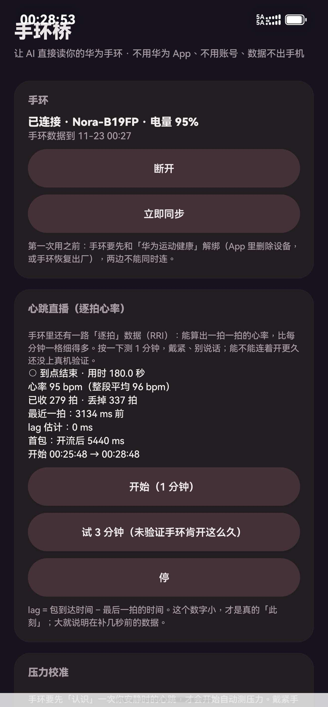

# Huawei Band Bridge · 手环桥

**让 AI 直接读你的华为手环。不用华为运动健康，不用华为账号，数据不上任何云。**
*Let your AI read your Huawei band directly: no Huawei Health app, no Huawei ID, no cloud.*（[English](README.en.md)）

> 🧪 **测试版**（当前 0.1.12）。协议核心在一台 HUAWEI Band 10 上跑通了，App 和 MCP 服务还在逐项上真机验证。
> 下面每一项都标了证据等级，没在真机上验过的不会写成「已验证」。



*0.1.1 的真机截图（HUAWEI Band 10 + HarmonyOS 手机），那次心跳直播的 lag 估计是 0 ms。0.1.4 起换了新界面，新截图之后补上。*

## 这是什么（3 行）

1. 一个 **Android App**：用蓝牙直接跟华为手环说华为自己的私有协议（含 HiChain 认证），把心率 / 血氧 /
   步数 / 科学睡眠 / 压力 / 情绪存在**手机本机**；
2. 手机上同时开一个 **MCP 服务**（7 个工具），让 Claude、Cursor 等 AI 客户端查你的数据；
3. 还能反过来把**天气**送进手环、让**手环音乐页控制手机播放器**。

不需要华为账号，也不用华为运动健康 —— 相反，手环要先跟华为运动健康**解绑**才能让第三方 App 连。

## 支持什么设备（兼容性矩阵）

| 设备 / 环境 | 状态 |
|---|---|
| HUAWEI Band 10（`Nora-B19FP`）+ HarmonyOS 7 手机 | **已实测**：认证、初始化、分钟数据、TruSleep、压力、情绪、逐拍心率 |
| HUAWEI Band 7 | **用户反馈，部分可用**：能连、能同步数据、表盘能看时间；但按侧边键会弹回「绑定华为运动健康」引导页，手环上的睡眠 / 压力页和手动开始运动用不了。0.1.12 起「复制诊断信息」能把原因带回来 |
| 其它 Band 型号（Band 9 / 11 等） | **未验证**。命令表是连上后探测的，理论上可适配，但差异要逐型号摸 |
| 其它固件版本（同型号） | **未验证**。华为更新固件可能改协议 |
| Honor Watch 5（PAKE / STS） | **部分移植**：算法在 `HiChainPakeUtils`，`AuthFlow` 还没接上调度 |
| 手机系统 | **只支持 Android 8.0+**（含 HarmonyOS 的 Android 兼容层）；iOS 不支持 |
| 被别的 App 当库嵌入（比如 Capacitor 插件） | **未验证**：`bandcore` 按「可复用库」写，但本仓库只演示 `app/` 这一个壳 |

## 能拿到什么（证据分级）

证据等级：`[VERIFIED]` 真机验证过 · `[IMPLEMENTED]` 已实现、未充分验证 · `[INFERRED]` 源码/协议推断 ·
`[UNSUPPORTED]` 已确认不支持。长文与实验记录见 [`docs/reverse-engineering.md`](docs/reverse-engineering.md)。

| 数据 / 能力 | 粒度 | 证据 |
|---|---|---|
| 心率 / 血氧 / 步数 / 静息心率 | 每分钟一格（手环**记录**粒度，不是 App 拉取粒度） | `[VERIFIED]` |
| 科学睡眠 TruSleep | 每分钟阶段：深睡 / 浅睡 / 快速眼动 / 清醒 + 睡眠分 | `[VERIFIED]` |
| 压力 | 手环自测（要先在 App 里静坐校准 1 分钟） | `[VERIFIED]` |
| 情绪 | 手环自测的原始值（愉悦度 / 激活度 / 状态码） | `[VERIFIED]` |
| 手环自带的情绪页 | 需要华为运动健康 + 华为云算法 | `[UNSUPPORTED]` |
| 逐拍心率（心跳直播） | 一拍一个值（≈1 秒），走 `0x19` RRI 流 | `[VERIFIED]`，但「实时性」措辞见下 |
| 实时心率（`0x07/0x1C`） | — | `[UNSUPPORTED]`：Band 10 命令表里没有，Gadgetbridge 也无实现 |
| 天气 → 手环 | 每小时 / 手环来要时 | `[IMPLEMENTED]` |
| 手环音乐页 → 手机播放器 | 实时（播放 / 暂停 / 上一首 / 下一首 / 音量） | `[IMPLEMENTED]` |
| 手机健康页可视化 | 横幅 + 六块概览 + 四个图表分区 | `[IMPLEMENTED]`（渲染未上真机） |
| 数据导出 | JSON + 每类一份 CSV | `[IMPLEMENTED]`（写盘未上真机） |

**逐拍心率的措辞要准确**：前两次真机测量（0.1.1）是 **87 有效拍 + 109 丢弃样本（合计 196）** 和
**279 + 337（616）**，lag 估计都是 0 ms；第三次（0.1.8，3 分钟）是 **264 + 352（616）**，
**44 个包、每包约 14 个样本（约 4 秒一包）**，结束时 lag 估计 **5900 ms**。所以手环会**成批推送**，
延迟是**秒级**：这条流是「一拍一个值，几秒内到」，不是「每一拍当场就到」。前两次 lag≈0 当时没记包数，
现在看不能拿来说明逐拍实时。「丢」是手环标为无效的样本（第三次 352 个全是 `sqi=0`），
**不是漏掉的心跳**。详见 [`docs/reverse-engineering.md` §4](docs/reverse-engineering.md) 和
[`docs/lab/hrlive-0x19.md`](docs/lab/hrlive-0x19.md)。

## 下载 / 安装

| 版本 | 文件 | 说明 |
|---|---|---|
| `0.1.12`（2026-11-26） | [`dist/huawei-band-bridge-0.1.12-debug.apk`](dist/huawei-band-bridge-0.1.12-debug.apk) | **推荐**。加「复制诊断信息」；补时区和老款账号命令（为 Band 7 排查引导页） |
| `0.1.11`（2026-11-25） | [`dist/huawei-band-bridge-0.1.11-debug.apk`](dist/huawei-band-bridge-0.1.11-debug.apk) | 修：白天小睡顶掉夜里那一觉（健康页和 `band_sleep`）；小睡算进总睡眠 |
| `0.1.10`（2026-11-24） | [`dist/huawei-band-bridge-0.1.10-debug.apk`](dist/huawei-band-bridge-0.1.10-debug.apk) | 连过的手环交给系统蓝牙自动连（切后台也能连上）；可选「登记到手机蓝牙」 |
| `0.1.9`（2026-11-23） | [`dist/huawei-band-bridge-0.1.9-debug.apk`](dist/huawei-band-bridge-0.1.9-debug.apk) | 新界面在真机上修好；后台保活；崩溃记录；心跳直播结论改为「成批推送、秒级延迟」 |
| `0.1.4`（2026-11-23） | [`dist/huawei-band-bridge-0.1.4-debug.apk`](dist/huawei-band-bridge-0.1.4-debug.apk) | 界面重做。**在 Android 16 上一打开就闪退，请用 0.1.9** |
| `0.1.3`（2026-11-23） | [`dist/huawei-band-bridge-0.1.3-debug.apk`](dist/huawei-band-bridge-0.1.3-debug.apk) | 修日志里的密钥泄露；心跳卡显示「有效 / 丢弃 / 样本合计 / 包数」；其余同 0.1.2 |
| `0.1.2`（2026-11-23） | [`dist/huawei-band-bridge-0.1.2-debug.apk`](dist/huawei-band-bridge-0.1.2-debug.apk) | 加「健康」页；心跳直播的「丢掉」拆成 `sqi0` / `范围` 两类 |
| `0.1.1`（2026-11-23） | [`dist/huawei-band-bridge-0.1.1-debug.apk`](dist/huawei-band-bridge-0.1.1-debug.apk) | 加「心跳直播」+ MCP 工具 `band_hr_live` |
| `0.1.0`（2026-11-22） | [`dist/huawei-band-bridge-0.1-debug.apk`](dist/huawei-band-bridge-0.1-debug.apk) | 第一个测试包 |

1. 手环先跟「华为运动健康」**解绑**（华为 App 里删除设备，或手环恢复出厂）。两边不能同时连。
2. 装 APK（允许「安装未知来源应用」）。debug 签名：装过别的签名的版本要先卸载。
3. 打开 App →「连接」，允许「附近的设备」「通知」。第一次连接手环上可能要点确认。
4. （可选）点「开始校准」静坐 1 分钟，之后手环会自己测压力。

下载：上面的 `dist/` 链接，或 [Releases](https://github.com/miitang16-dot/huawei-band-bridge/releases)
（GitHub 的 raw 域名在部分网络下不稳）。每个版本的校验值 / 构建方式 / 已验证清单见
[`RELEASE-0.1.12.md`](RELEASE-0.1.12.md)、[`RELEASE-0.1.11.md`](RELEASE-0.1.11.md)、[`RELEASE-0.1.10.md`](RELEASE-0.1.10.md)、[`RELEASE-0.1.9.md`](RELEASE-0.1.9.md)、[`RELEASE-0.1.4.md`](RELEASE-0.1.4.md)、[`RELEASE-0.1.3.md`](RELEASE-0.1.3.md)、[`RELEASE-0.1.2.md`](RELEASE-0.1.2.md)、
[`RELEASE-0.1.1.md`](RELEASE-0.1.1.md)。

## 用 MCP 查数据

「MCP 服务」那张卡里有地址（`http://手机IP:8848/mcp`）和口令，点「复制配置」，粘到 AI 客户端：

```json
{
  "mcpServers": {
    "huawei-band": {
      "type": "http",
      "url": "http://192.168.1.23:8848/mcp",
      "headers": { "Authorization": "Bearer <口令>" }
    }
  }
}
```

AI 和手机要在同一个局域网（或 Tailscale 之类的组网）。不能设置请求头的客户端可以用 `…/mcp?token=<口令>`。

| 工具 | 干什么 |
|---|---|
| `band_status` | 连没连上、型号、电量、最新数据到几点、压力校准了没 |
| `band_now` | 最新的心率 / 血氧 / 静息心率 / 今天步数 / 压力 / 情绪 / 昨晚睡眠（每项带记录时间） |
| `band_day` | 某天或某时段的心率 / 血氧 / 步数统计 + 分段序列（长时段自动放粗，写明粒度） |
| `band_sleep` | 某天早上醒来那一觉：入睡 / 醒来、睡眠分、深浅 REM 清醒分钟、睡时心率血氧、阶段时间线；同一天的小睡单独列出（`naps` / `napMin`，`dayTotalMin` = 夜里 + 小睡） |
| `band_stress` | 某天手环测的压力（1–99 + 档位） |
| `band_emotion` | 某天手环测的情绪（愉悦度 / 激活度 / 三档状态） |
| `band_hr_live` | 逐拍心率：传 `seconds`（5–180）测一段；不传读当前/最近一次。没在测就说没在测 |

没有记录就返回 null / 空，**不会补数、不会编数**。`band_hr_live` 的字段（固定）：
`ok / running / bpm / bpm_avg / beats / dropped / dropped_sqi0 / dropped_range /
samples / packets / window_ms / lag_ms / last_beat_ms_ago / started_at / device / unverified`。

服务安全用法（局域网 + 口令、不要映射公网、泄露后换口令）见 [`SECURITY.md`](SECURITY.md)。

## 构建 / 测试

```powershell
$env:JAVA_HOME='C:\path\to\jdk-21'
$env:ANDROID_HOME='C:\path\to\android-sdk'
.\gradlew.bat :app:assembleDebug             # 产物 app\build\outputs\apk\debug\app-debug.apk
.\selftest.ps1                               # 纯协议层离线自测，不需要手环 / Android SDK
```

- 离线自测当前 **251 项**，覆盖 TLV / 帧 / CRC / 分片 / 时间换算 / RRI 换算与丢弃分类；
  测不到什么见 [`docs/TESTING.md`](docs/TESTING.md)。
- CI：`.github/workflows/build.yml`（push / PR 跑自测 + `assembleDebug`）。自测 job 在 GitHub 上跑通了；
  构建 job 之前卡在安装 Android SDK 那一步，0.1.4 改成用运行环境自带的 SDK。

## 架构：可复用的协议库 + 一个参考实现

本仓库是两层：

- **`bandcore/`：可复用的华为手环协议库**。不依赖 `app` 模块、不依赖 UI；只有 BLE 传输层需要 `Context`。
  核心入口是 `BandSession`（扫描 → 认证 → 初始化 → 每分钟同步）与各 Store / Sync / HrLiveSession。
- **`app/`：参考实现**。主界面 + 「健康」页 + 前台服务 + 手机上的 MCP 服务，
  用来演示 `bandcore` 能做什么，也是日常用的那个 App。

```java
BandSession s = new BandSession(context, new BandSession.Hooks() {
    @Override public void onData(int newSamples) { /* 新数据 */ }
    @Override public JSONObject weather() { return myWeather; }        // 可选：给手环的天气
    @Override public void musicButton(int b) { /* 手环音乐页按键 */ }    // 可选
});
s.start();                                    // 扫描 → 认证 → 初始化 → 每分钟同步
s.samples().query(fromSec, toSec);            // 心率 / 血氧 / 步数 / 静息心率
s.truSleep().query(fromMs, toMs);             // 科学睡眠
s.stress().query(fromMs, toMs);               // 压力
s.emotion().query(fromMs, toMs);              // 情绪
s.hrLiveStart(60, (bpm, avg, beats, lagMs, lastBeatMsAgo) -> { });   // 心跳直播（逐拍）
HrLiveSession.Snapshot live = s.hrLiveSnapshot();                    // 结束后也留着最后一次
```

数据流：手环 →（BLE 私有协议）→ `bandcore` → 本机 JSON 存档 →（MCP，本机 8848 口）→ AI 客户端。
**中间没有服务器。** 代码结构与协议细节见 [`docs/reverse-engineering.md`](docs/reverse-engineering.md)。

## 当前限制（详情见 [docs/ROADMAP.md](docs/ROADMAP.md)）

- **只支持 Android 8.0+**，没有 iOS。
- 手环必须跟华为运动健康解绑，且同一时间只能有一个 App 连它。
- **不是实时心率**：手环约每分钟记一格；逐拍流能按需测一段，但不是「一直开着看心跳」。
- 手环自带的情绪页打不开（要华为 App + 云端算法）；App / MCP 里的情绪是原始值。
- 数据保留期：分钟数据 10 天、科学睡眠 60 晚、压力 / 情绪 30 天。
- 逆向协议：华为更新固件可能失效；Release 包是 debug 签名，不是商店签名。
- 这些都是健康数据，**不是医疗诊断**。

## 安全 / 隐私

- 健康数据只存手机本地（App 私有目录），不上传、不联网；**唯一的联网**是天气（Open-Meteo，
  只发四舍五入到 0.1°≈10 km 的粗略位置）。
- 设备身份（`authkey` / 伪造的 `device_mac` / `android_id`）是本机配对产物，别拷给别人；
  MCP 口令是本机随机生成的，别把 8848 暴露到公网。
- 从 0.1.3 起，日志与 `toString` 不再输出任何密钥 / 口令 / 包体内容。
- 怎么报安全问题、MCP 怎么用才安全：见 [`SECURITY.md`](SECURITY.md)。

## 参与

- 改协议前先读 [`docs/TESTING.md`](docs/TESTING.md)（哪些能离线测、哪些必须上真机）；
  跑 `./selftest.ps1`（或 `./selftest.sh`）保持全绿。
- 没有第三方依赖；构建只要 JDK 21 + Android SDK 36。真机结论请附探针（App 日志页）里的证据，
  不要把推断写成已验证。

## 致谢 / 许可

- 协议实现大量移植自 [Gadgetbridge](https://codeberg.org/Freeyourgadget/Gadgetbridge)（AGPL-3.0），
  上游版本 `7257742`（2026-11-18）；来源文件保留原版权头，详见 [`NOTICE.md`](NOTICE.md)。
- 本项目以 **AGPL-3.0** 发布（[`LICENSE`](LICENSE)）：分发或提供网络服务时要给出完整源码。
- 零第三方运行时依赖（纯 Android SDK / JDK）。
- 与华为无关，非官方；Huawei / HUAWEI Band / TruSleep 是华为的商标。
